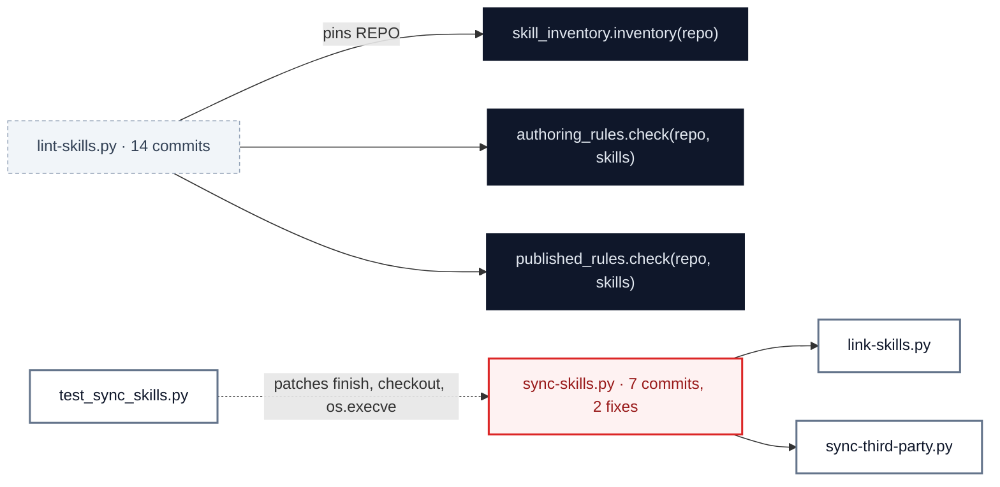

# skills: the two handed-off commands have seams already; they need small fixes, not a redesign

`2026-11-22` · at `fbb2024` (`test/reply-resolve`, the top of the test-review stack) · scope: the two hand-offs from [test-review 2026-11-22](../../test-review/2026-11-22-tooling/README.md#hand-offs): `scripts/sync-skills.py`'s rerun and finish steps, and `scripts/lint-skills.py`'s repo root · glossary: `GLOSSARY.md` · ADRs read: 0008, 0012

**Jump to:** [Status](#status) · [Where it hurts](#where-it-hurts) · [Smaller findings](#smaller-findings) · [Recommendation](#recommendation)

## Status

The backlog, in rank order. After the scan only three parts of the report change: this table (with the **Smaller findings** entry for each `S` row a Build phase adds), each card's **Decisions**, and **Departures**. The findings stay as found.

| ID | Candidate | Strength | Door | Lens | Status | Branch | PR | Breaking | Notes |
|---|---|---|---|---|---|---|---|---|---|
| [S1](#s1--lint-skillspy-takes-its-repo-like-the-modules-it-calls) | `lint-skills.py` takes its repo like the modules it calls | - | ↔ two-way | maintainability | pr-open | `refactor/sync-and-lint-seams` | #106 | no | |
| [S2](#s2--one-checkout-step-for-a-sync-and---check-tested-at-the-command) | One checkout step for a sync and `--check`, tested at the command | - | ↔ two-way | maintainability | pr-open | `refactor/sync-and-lint-seams` | #106 | no | |

Strength: 🟢 Strong · 🟡 Worth exploring · ⚪ Speculative · 🔴 live defect (a bug reproduced during the scan).
Door: ↔ two-way (a revert undoes it) · 🚪 one-way (a data migration, a published wire or file format, deleted user data; stops at Step 6 for the user).
Lens: `deepening` · `maintainability` · `coupling`.
Status: `todo` · `in-progress` · `pr-open` · `merged` · `blocked` · `dropped`. `blocked` and `dropped` always carry a reason in Notes.

## Where it hurts

Neither direction holds a candidate. `lint-skills.py` passes the deletion test as an adapter: deleting it would put the same three calls in CI and lefthook, so it stays a thin adapter, and every module behind it already takes `repo`. `sync-skills.py` is one command over three steps; its friction is one step placed in two flows, which is a smaller finding.

**Correction to the test-review hand-off:** both commands already have a seam, the command run from a checkout. `sync-skills.py` finds its repo and its sibling scripts from its own location (`scripts/sync-skills.py:30-31`), so a fixture checkout holding a copy of it and stub siblings tests the pull, the rerun and the steps with no patching. The tests that patch the module's own `finish` and `checkout` were waste with a seam to rewrite them at, not a hand-off; S2 does that rewrite.

## Smaller findings

### S1 · `lint-skills.py` takes its repo like the modules it calls

`scripts/lint-skills.py:33-41` · own PR, with S2

`inventory`, `authoring_rules.check` and `published_rules.check` all take `repo`, but the script's top-level body pins `REPO`, so its exit-1 path, the one CI and lefthook rely on, can't be driven, and `tests/tooling/test_lint_skills.py` only ever lints the clean repo. Move the body into `main(repo=REPO) -> int` and add a test that lints a broken fixture repo (as `tests/tooling/skill_repo.py` builds) and expects the problems printed and exit 1.

### S2 · One checkout step for a sync and `--check`, tested at the command

`scripts/sync-skills.py:80-111` · `tests/tooling/test_sync_skills.py:47,85-104` · own PR, with S1

The checkout runs in `main` for a sync, so a pull can rerun the new copy, but `finish` inserts it again for `--check` (`:108`); two fixes in one day (`bfe71f1`, `3d26c25`) were the modes drifting across that split, and the tests reach the rerun only by patching `finish`, `checkout` and `os.execve`, and by setting `sync_skills.REPO` without restoring it (`:47`). Make the checkout the first step of one sequence in both modes, with the rerun right after it in a sync, and replace the two patching tests with one that runs the command from a fixture checkout holding `sync-skills.py` and stub siblings, asserting the pull, the rerun of the pulled copy and a single checkout from its output.

## Recommendation

> [!IMPORTANT]
> **No 🟢 Strong candidate.** Both directions come down to an adapter that should take a dependency it pins, and one step placed in two flows.
>
> **Proposed batch:** S1 + S2 in one PR on `refactor/sync-and-lint-seams`, stacked on the test-review stack (#103), since `tests/tooling/test_lint_skills.py` also changes in #101.

## Departures

<!-- filled during implementation: where a PR deliberately differs from this report, and why -->
