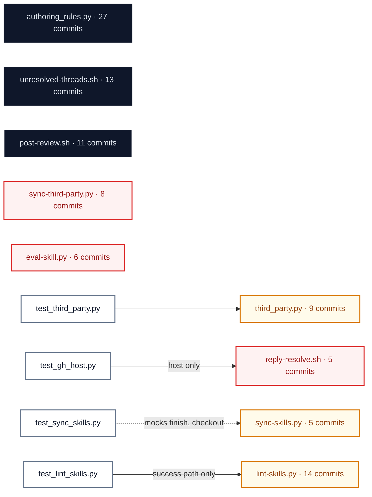

# skills: the commands around well-tested modules go unpinned, and every commit waits 19 s for the suite

`2026-11-22` · at `2b3450f` (`main`) · scope: the top 26 rows of `test-history.py drift` (6 months, 484 commits) · glossary: `GLOSSARY.md` · ADRs read: 0001-0012

**Jump to:** [Status](#status) · [Vitals](#vitals) · [Where it hurts](#where-it-hurts) · [Hand-offs](#hand-offs) · [Smaller findings](#smaller-findings) · [Recommendation](#recommendation) · cards: [C1](C1-suite-to-pre-push.md) · [C2](C2-pin-sync-third-party.md) · [C3](C3-pin-reply-resolve.md) · [C4](C4-pin-eval-skill.md)

## Status

The backlog, in rank order. After the scan only this table (including `S` rows Build adds, with their Smaller findings entries), any **Seams** moved at the checkpoint, the cards' **Decisions** and **After**, and **Departures** change.

| ID | Candidate | Kind | Strength | Door | Fix | Status | Branch | PR | Notes |
|---|---|---|---|---|---|---|---|---|---|
| [C1](C1-suite-to-pre-push.md) | Take the 19 s suite off pre-commit | 🔧 infra | 🟢 Strong | ↔ two-way | `direct` | todo | `ci/suite-off-pre-commit` | | first: every later commit in the batch pays it |
| [C2](C2-pin-sync-third-party.md) | Pin `sync-third-party.py` and its GitHub adapter | 🕳️ blind spot | 🟢 Strong | ↔ two-way | `tdd` | todo | `test/sync-third-party` | | |
| [C3](C3-pin-reply-resolve.md) | Pin `reply-resolve.sh` at its command | 🕳️ blind spot | 🟢 Strong | ↔ two-way | `tdd` | todo | `test/reply-resolve` | | |
| [C4](C4-pin-eval-skill.md) | Pin `eval-skill.py`'s command | 🕳️ blind spot | 🟡 Worth exploring | ↔ two-way | `tdd` | todo | `test/eval-skill` | | |
| [S1](#s1--cis-ruff-skips-the-bundled-python-scripts) | CI's ruff skips the bundled Python scripts | 🔧 infra | - | ↔ two-way | `direct` | todo | rides with C1 | | |
| [S2](#s2--no-documented-single-test-command) | No documented single-test command | 🔧 infra | - | ↔ two-way | `direct` | todo | rides with C1 | | |
| [S3](#s3--a-skip-the-documented-command-can-never-take) | A skip the documented command can never take | 🗑️ waste | - | ↔ two-way | `prune-tests` | todo | rides with C1 | | |

Kind: 🕳️ blind spot (fixed with tdd) · 🗑️ waste (fixed with prune-tests) · 🔧 infra (a direct change).
Strength: 🟢 Strong · 🟡 Worth exploring · ⚪ Speculative · 🔴 live defect (a bug reproduced during the scan).
Door: ↔ two-way (a revert undoes it) · 🚪 one-way (an unregenerable fixture or golden file, branch protection or required checks, a test a contract names).
Status: `todo` · `in-progress` · `pr-open` · `merged` · `blocked` · `dropped`. `blocked` and `dropped` always carry a reason in Notes.

## Vitals

| Measure | Value | From |
|---|---|---|
| Suite | 356 tests, 18.8 s (serial; `tests/skill_scripts/` is ~18 s of it, `tests/tooling/` ~0.5 s) | `uv run --locked --no-build python3 -m unittest discover -s tests -t . --durations 25` |
| Slowest five | `test_post_review…diff_too_big_for_argv_still_posts` 0.64 s · `test_test_history…git_quotes_are_kept` 0.42 s · `test_help…usage_and_exits_0` 0.39 s · `test_post_review…pr_too_big_for_gh_pr_diff_still_posts` 0.31 s · `test_gh_host…enterprise_checkout…` 0.30 s | same |
| Slowest modules | `test_post_review` 3.0 s · `test_test_history` 2.9 s · `test_co_change` 2.0 s · `test_pick_repo` 1.9 s · `test_check_file_tokens` 1.8 s | `python3 -m unittest tests.<module>` each |
| One test file | 0.08 s (`tests.tooling.test_catalog`) · 3.0 s (`tests.skill_scripts.test_post_review`) | `uv run --locked --no-build python3 -m unittest tests.<module>` |
| Pre-commit | full suite on any staged `.py` or `skills/**` file, ~19 s wall; no pre-push hook | `lefthook.yml` `tests` job |
| CI test workflow | Lint: median 29 s, 26.7 runs/week, 0 reruns, 0 failures in 164 runs (43 days) | `gh run list --limit 200 --json workflowName,conclusion,attempt,startedAt,updatedAt` |
| Fix commits without a test | 15 of 75 (6 months) | `test-history.py fixes` |
| Refactor commits that changed a test | 14 of 29; the diffs are import paths and tests that moved with the code | `test-history.py refactors` |
| Disabled tests | 3 conditional skips (`test_co_change.py:138`, `test_test_history.py:228`, `test_lint_skills.py:17`) · 0 xfail · 0 retry | `git grep -nE 'skipTest\|skipUnless\|skipIf\|expectedFailure' -- tests` |
| Isolation | passes shuffled (`pytest -p randomly`, 2 orders), with an empty `HOME` (no git identity, default branch `master`), and leaves `git status` clean | `uvx --with pytest-randomly pytest -p randomly tests`; `HOME=$(mktemp -d) uv run … unittest discover` |
| Coverage | not measured: no coverage config, CI uploads none, SonarQube MCP not authorized | |

## Where it hurts

The modules are well guarded (`authoring_rules.py` 70% own-test share; 7 of the 15 fix commits that came without a test were pinned by later tests); the gaps are the commands that wrap them: `sync-third-party.py`, `eval-skill.py` and `reply-resolve.sh` took 19 commits in 6 months, 6 of them fixes, and only the 3 host fixes in `reply-resolve.sh` have a test.

## Hand-offs

Behaviour with no seam to test at; a module question for `/arch-review`, not a test one.

- `scripts/sync-skills.py:80-111`: the "a pull reruns the updated script once, and the rerun doesn't pull again" behaviour (fix `bfe71f1`) is reachable only by patching the module's own `finish` and `checkout` (`tests/tooling/test_sync_skills.py:87-98`); those tests stay until a seam exists → `/arch-review sync-skills.py's rerun and finish steps`
- `scripts/lint-skills.py:32-40`: the exit-1 path CI and lefthook rely on can't be driven, since `REPO` is fixed by the file's location (`scripts/tooling/skill_inventory.py:20`); only the clean repo is ever linted from a test → `/arch-review lint-skills.py's repo root`

Not suggested: pruning the prose pins in `tests/skills/test_review_skills_agree.py`. They are implementation-shaped, but ADR 0008's Consequences chose them to catch drift between arch-review and test-review.

## Smaller findings

### S1 · CI's ruff skips the bundled Python scripts

`.github/workflows/lint.yml:42` · rides with C1

CI runs `ruff check scripts tests`, so `skills/*/*/scripts/*.py` (`co-change.py`, `test-history.py`, `check-file-tokens.py`, `check-dashes.py`) are linted only when lefthook sees them staged; a commit with `--no-verify` reaches `main` unlinted. Add `skills` to the CI paths (`uvx ruff@0.17.0 check skills` passes today).

### S2 · No documented single-test command

`AGENTS.md:13` · rides with C1

AGENTS.md shows one module (`tests.tooling.test_catalog`) but not one test, which the `tdd` loop runs most. Add the dotted form (`…unittest tests.skill_scripts.test_post_review.PostReviewTest.test_summary_without_comments_posts`, 0.7 s).

### S3 · A skip the documented command can never take

`tests/tooling/test_lint_skills.py:17` · rides with C1

`skipUnless(shutil.which("uv"))` guards nothing: the suite runs through `uv run`, so `uv` is always on `PATH`, and the skip would only ever hide the one test of `lint-skills.py` as a command. Drop the decorator so a missing `uv` fails loudly.

## Recommendation

> [!IMPORTANT]
> **Start with [C1 · Take the 19 s suite off pre-commit](C1-suite-to-pre-push.md)**: every commit pays 19 s for it today, including every commit the rest of this batch makes.
>
> **Proposed batch** (every 🟢 Strong, in order): C1 (+ S1, S2, S3) → C2 → C3

## Departures

<!-- filled during implementation: where a PR deliberately differs from this report, and why -->
