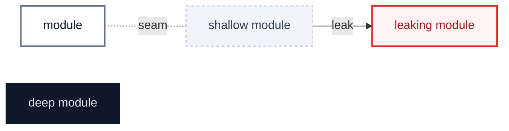
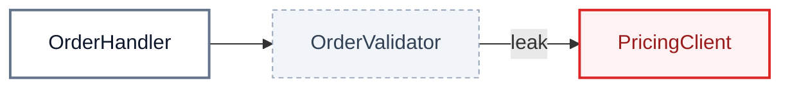

<!--
  arch-review report overview. Copy to docs/arch-review/YYYY-MM-DD-<slug>/README.md and fill it in;
  each candidate gets its own file beside it from card-template.md.
  Keep the section order, the badge emoji, and the classDef block: every report looking the same is the point.
  Replace each <placeholder>; repeat the marked blocks per row / finding; drop "Since the last review" on a first scan.
  Stay under the project's token budget (5,000 tokens = 20 KB without one); over it, move Smaller findings to smaller-findings.md.
  Mermaid: quote every label ("like this") and never write {{ }} in a diagram; double braces are Mermaid's hexagon shape.
  Delete this comment.
-->

# <repo>: <one-line headline>

`<YYYY-MM-DD>` · at `<sha>` (`<branch>`) · scope: <direction, or the churn hot spots and how they were found> · glossary: `<GLOSSARY.md | none>` · ADRs read: <list>

**Jump to:** [Status](#status) · [Where it hurts](#where-it-hurts) · [Smaller findings](#smaller-findings) · [Recommendation](#recommendation) · cards: [C1](C1-<card-slug>.md) · [C2](C2-<card-slug>.md)

Legend

## Status

The backlog, in rank order. After the scan only three parts of the report change: this table, each card's **Decisions**, and **Departures**. The findings stay as found.

| ID | Deepening | Strength | Door | Lens | Status | Branch | PR | Breaking | Notes |
|---|---|---|---|---|---|---|---|---|---|
| [C1](C1-<card-slug>.md) | <names the deepening> | 🟢 Strong · 🔴 live defect | ↔ two-way | deepening | todo | `refactor/<slug>` | | | |
| [S1](#s1--title) | <smaller finding> | — | ↔ two-way | maintainability | todo | rides with C1 | | | |

Strength: 🟢 Strong · 🟡 Worth exploring · ⚪ Speculative · 🔴 live defect (a bug reproduced during the scan).
Door: ↔ two-way (a revert undoes it) · 🚪 one-way (a data migration, a published wire or file format, deleted user data; stops at Step 6 for the user).
Status: `todo` · `in-progress` · `pr-open` · `merged` · `blocked` · `dropped`. `blocked` and `dropped` always carry a reason in Notes.

## Where it hurts

<one line: what the marked modules have in common, e.g. "touched in 31 of the last 40 commits">

## Since the last review

- `<YYYY-MM-DD> C3` — <merged in #41 | still open | dropped because …>

## Smaller findings

### S1 · <title>

`<path:line>` · rides with <C1 | own PR>

<what, and the fix, in two sentences>

## Recommendation

> [!IMPORTANT]
> **Start with [C1 · <title>](C1-<card-slug>.md)** — <one sentence on why this one first>.
>
> **Proposed batch** (every 🟢 Strong, in order): C1 → C3 → C2

## Departures

<!-- filled during implementation: where a PR deliberately differs from this report, and why -->
