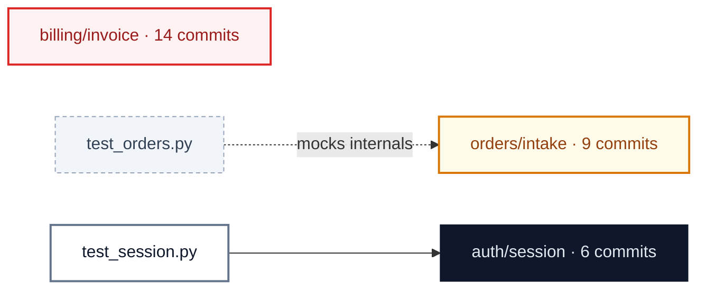

<!--
  test-review overview. Copy to docs/test-review/YYYY-MM-DD-<slug>/README.md and fill it in;
  each candidate gets its own file beside it from card-template.md.
  Keep the section order, the badge emoji, and the classDef block: every report looking the same is the point.
  Replace each <placeholder>; repeat the marked rows; drop "Hand-offs" when empty and "Since the last review" on a first review.
  Stay under the project's token budget (5,000 tokens = 20 KB without one); over it, move Smaller findings to smaller-findings.md.
  Mermaid: quote every label ("like this") and never write {{ }} in a diagram; double braces are Mermaid's hexagon shape.
  Delete this comment.
-->

# <repo>: <one-line headline>

`<YYYY-MM-DD>` · at `<sha>` (`<branch>`) · scope: <direction, or the churn hot spots and how they were found> · glossary: `<GLOSSARY.md | none>` · ADRs read: <list>

**Jump to:** [Status](#status) · [Vitals](#vitals) · [Where it hurts](#where-it-hurts) · [Hand-offs](#hand-offs) · [Smaller findings](#smaller-findings) · [Recommendation](#recommendation) · cards: [C1](C1-<card-slug>.md) · [C2](C2-<card-slug>.md)

## Status

The backlog, in rank order. After the scan only this table, the cards' **Decisions** and **After**, and **Departures** change.

| ID | Candidate | Kind | Strength | Door | Fix | Status | Branch | PR | Notes |
|---|---|---|---|---|---|---|---|---|---|
| [C1](C1-<card-slug>.md) | <names the fix> | 🕳️ blind spot | 🟢 Strong · 🔴 live defect | ↔ two-way | `tdd` | todo | `test/<slug>` | | |
| [C2](C2-<card-slug>.md) | <names the fix> | 🗑️ waste | 🟢 Strong | ↔ two-way | `prune-tests` | todo | `test/<slug>` | | |
| [C3](C3-<card-slug>.md) | <names the fix> | 🔧 infra | 🟡 Worth exploring | ↔ two-way | `direct` | todo | `ci/<slug>` | | |
| [S1](#s1--title) | <smaller finding> | 🗑️ waste | — | ↔ two-way | `prune-tests` | todo | rides with C2 | | |

Kind: 🕳️ blind spot (fixed with tdd) · 🗑️ waste (fixed with prune-tests) · 🔧 infra (a direct change).
Strength: 🟢 Strong · 🟡 Worth exploring · ⚪ Speculative · 🔴 live defect (a bug reproduced during the scan).
Door: ↔ two-way (a revert undoes it) · 🚪 one-way (an unregenerable fixture or golden file, branch protection or required checks, a test a contract names).
Status: `todo` · `in-progress` · `pr-open` · `merged` · `blocked` · `dropped`. `blocked` and `dropped` always carry a reason in Notes.

## Vitals

| Measure | Value | From |
|---|---|---|
| Suite | <n> tests, <s> s | `<command>` |
| Slowest five | `<test>` <s> s · … | `<command>` |
| One test file | <s> s | `<command>` |
| CI test workflow | median <m> min, <n> runs/week, <n> reruns | `gh run list …` |
| Fix commits without a test | <n> of <m> (6 months) | `test-history.py fixes` |
| Refactor commits that changed a test | <n> of <m> | `test-history.py refactors` |
| Disabled tests | <n> skip · <n> xfail · <n> retry | `git grep -nE …` |
| Coverage | <only when the project measures it> | `<source>` |

## Where it hurts

<one line of evidence, e.g. "the three red modules took 9 of the 11 untested fix commits">

## Hand-offs

Behaviour with no seam to test at; a module question for `/arch-review`, not a test one.

- `<path:line>` — <why there's no seam> → `/arch-review <direction>`

## Since the last review

- `<YYYY-MM-DD> C3` — <merged in #41 | still open | dropped because …>
- Vitals: <suite 212 s → 140 s; untested fixes 11 → 4>

## Smaller findings

### S1 · <title>

`<path:line>` · rides with <C2 | own PR>

<what, and the fix, in two sentences>

## Recommendation

> [!IMPORTANT]
> **Start with [C1 · <title>](C1-<card-slug>.md)** — <one sentence on why this one first>.
>
> **Proposed batch** (every 🟢 Strong, in order): C1 → C2

## Departures

<!-- filled during implementation: where a PR deliberately differs from this report, and why -->
